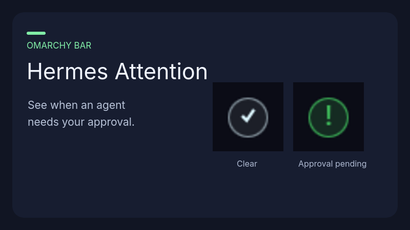

# Hermes Attention

See when Hermes Agent needs you to approve a command, even from another workspace. A pulsing Omarchy badge and a persistent desktop notification draw your attention to the pending request. Click the badge to read the command, the reason it was flagged, and when the request arrived.



## Install

Requires Omarchy 4.x, [Hermes Agent](https://github.com/NousResearch/hermes-agent) with shell hooks, and Git for hook setup, and the `jq`, `notify-send`, and `busctl` commands.

```sh
omarchy plugin add https://github.com/CallMeBakugo/omarchy-hermes-attention.git
```

Use that same plugin checkout to install the hook. Copy the full SHA for the snapshot you intend to install from the [Marketplace listing](https://plugins.omarchy.org/plugin.html?id=bakugo.hermes-attention) or the commit you reviewed on GitHub. Set `reviewed_commit` to that value. The Omarchy command above fetches the current branch, so check the SHA and the two hook files before running the installer or enabling the widget.

```sh
plugin_dir="$HOME/.config/omarchy/plugins/bakugo.hermes-attention"
reviewed_commit='<full 40-character reviewed commit SHA>'
test "$(git -C "$plugin_dir" rev-parse HEAD)" = "$reviewed_commit" &&
  git -C "$plugin_dir" diff --quiet "$reviewed_commit" -- install.sh attention.sh &&
  bash "$plugin_dir/install.sh" "$reviewed_commit" &&
  omarchy plugin enable bakugo.hermes-attention
```

If the installed checkout is at a different commit, inspect it before using it or check out the exact reviewed commit in the installed plugin directory and rerun the checks. The installer copies the hook from that commit. It does not clone another repository. When updating an existing hook, compare it with the reviewed copy, then rerun the same command with `--replace` after the SHA to approve replacing it. Hermes continues to use the installed copy until you explicitly replace it.

Add the installed hook's absolute path to both event lists under `hooks` in your Hermes `config.yaml`. Merge these entries with any existing hooks. Your Hermes home is `~/.hermes` unless you set `HERMES_HOME`.

```yaml
hooks:
  pre_approval_request:
    - command: "/absolute/path/to/.hermes/agent-hooks/attention.sh"
  post_approval_response:
    - command: "/absolute/path/to/.hermes/agent-hooks/attention.sh"
```

Restart Hermes, approve its first-use prompt for the hook when requested, then run `hermes hooks doctor` to check the setup. The included `test-payload.json` can be used with `hermes hooks test pre_approval_request --payload-file "$plugin_dir/test-payload.json"`.

## Use

- Left-click the badge to inspect the pending prompt.
- Right-click or press **S** in the panel to silence the badge and its notification. Approval decisions stay in Hermes.
- Pending prompts share one notification. The badge returns to its clear state when the last prompt is answered.
- Alerts go quiet after 30 minutes without a new prompt. Change the timeout with `omarchy bar set bakugo.hermes-attention staleMin 15`.

The desktop notification contains a generic message. Command details are kept in an owner-only local state file and shown in the flyout. Prompts handled by Hermes' automatic approval surface are filtered out.

## Remove

```sh
omarchy plugin remove bakugo.hermes-attention --yes
```

Remove this script's two entries from your Hermes hook configuration, revoke its approval if applicable, and delete the installed `agent-hooks/attention.sh` file. Keep any unrelated hooks.

[MIT license](LICENSE).
